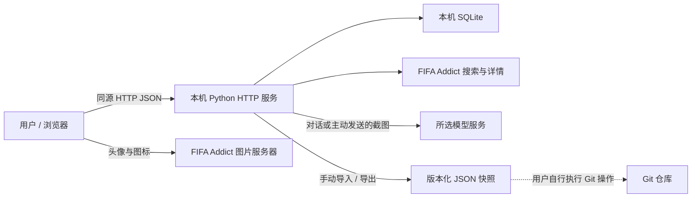

# 红魔战术室：项目技术文档

> 基于当前工作区源码整理，检查日期：2026-11-27。本文描述现有实现，而非功能承诺或未来规划；第三方接口、模型及其能力可能变化。用户操作见 [README](README.md)，稳定需求与验收边界见 [项目需求与维护基线](PROJECT_REQUIREMENTS.md)，维护规则见 [AGENTS.md](AGENTS.md)。本文覆盖整个项目，而非特定提交的变更。

## 1. 项目定位与范围

本项目是 Windows 本机单用户 FC Online 阵容和手动排位战术助手。默认阵容名称为“曼联队套”，阵型为 4-1-2-3；用户可编辑位置及球员信息，通过 FIFA Addict 按需搜索和缓存球员，向所选模型询问战术，或经用户确认将截图交给视觉模型识别。它不自动操作游戏，不提供多用户、自动云同步或官方数据库。

FIFA Addict 是独立第三方来源，不保证国服上架、时效、完整性或官方准确性。基础能力不等于强化或队套加成后的数值；本工具不判断队套资格或价格，仅按照用户确认的曼联全员假设及指定规则估算球场总评。模型回答与截图识别是建议或候选结果，需用户核对，不能视为确定事实。

## 2. 技术栈与运行环境

| 项目 | 当前实现 |
| --- | --- |
| 服务端 | Python 3.10+ 标准库，`http.server.ThreadingHTTPServer`、`urllib`、`sqlite3` 等；无额外 Python 依赖 |
| 页面 | 原生 HTML、CSS、JavaScript；浏览器通过同源 HTTP JSON API 访问服务 |
| 存储 | 本机 SQLite；手动同步使用 UTF-8 JSON 快照 |
| 操作系统 | Windows；页面密钥管理使用当前 Windows 用户的 DPAPI |
| 模型 | 本机 Ollama 或 OpenAI Chat Completions 兼容服务，按请求选择 |
| 第三方数据 | FIFA Addict 中文站及其接口；部分图片由浏览器直接加载 |

从仓库根目录运行 `python server.py`，默认访问 `http://127.0.0.1:8765`。`FC_PORT` 可在启动前改变端口。服务只绑定 IPv4 回环地址，不是对外服务；屏幕捕获需要支持 `getDisplayMedia` 且经用户授权的浏览器。模型、网络和截图功能均有各自的运行条件，详见 README。

## 3. 代码组织与架构

| 路径 | 责任 |
| --- | --- |
| `server.py` | 本机 HTTP 服务、静态文件白名单、请求校验、API 路由和响应 |
| `app/storage.py` | SQLite 连接及建表、球员 JSON 缓存、阵容默认值和校验 |
| `app/data_source.py` | FIFA Addict 搜索、详情链接校验、页面和接口抓取、解析与规范化 |
| `app/analysis.py` | 将已保存阵容及关联球员整理成模型上下文摘要 |
| `app/agent.py` | 模型配置、地址限制、配置状态、对话上下文及兼容接口请求 |
| `app/vision.py` | 图片 Data URL 校验、视觉模型请求及候选结果解析 |
| `app/secrets.py` | OpenAI、DeepSeek 密钥来源和 Windows DPAPI 加解密 |
| `app/sync.py` | 快照编码、校验、状态哈希、冲突检测及导入导出 |
| `static/index.html` | 页面结构、表单与弹窗 |
| `static/app.js` | 页面状态、渲染、API 调用、截图、模型、密钥和同步交互 |
| `static/styles.css` | 页面布局、组件、球场、弹窗与响应式样式 |
| `data/assistant.sqlite3` | 首次访问存储时创建的本机数据库；被 Git 忽略 |
| `sync/snapshot.json` | 用户主动导出的手动同步文件；初始不一定存在 |



模型服务可为本机 Ollama 或在线服务。即使访问本机 Ollama，若用户选用其云模型，数据仍可能到达远程服务商。图中连接不表示第三方服务已验证可用。

## 4. 主要业务流程

### 4.1 阵容编辑与关联

1. 前端初始化读取已保存阵容及球员缓存；无阵容记录时返回默认 11 个首发位置及 7 个替补席位；旧数据缺少替补时读取为空席位。替补支持与首发相同的球员信息和关联，但不设置个人战术，也不自动与首发交换。球场坐标固定，位置键依次为 `LW`、`ST`、`RW`、`LCM`、`RCM`、`CDM`、`LB`、`LCB`、`RCB`、`RB`、`GK`。
2. 用户编辑当前槽位的位置、姓名、赛季、强化等级，并按场上位置从下拉列表选择个人战术，或在“球队战术”弹窗中编辑球队战术后，前端提交完整阵容。个人战术选项参考 [FC Online 官方新手指南](https://fco.qq.com/cp/a20230905newbie/)、[官方后场战术介绍](https://fco.qq.com/webplat/info/news_version3/33965/34721/34727/34735/m20160/201801/681703.shtml)及[旧版位置资料](https://www.inven.co.kr/webzine/news/?news=199309&site=fifaonline4)；选项可能随游戏版本变化，LM/RM 参考旧资料，须以游戏内为准。变更场上位置前须确认清除已选个人战术，进攻和防守倾向保留；旧数据中不匹配的值显示为保留旧值，直至用户替换或清除。关闭弹窗或按 Esc 时，未保存的修改需确认后才丢弃；保存失败会保留输入。服务端校验槽位顺序、战术字段及数值边界，以及非空 `player_id` 是否存在于缓存；这些边界不是游戏官方规则。个人战术归属槽位，换人或清空球员时保留；未填写项为未设置，截图识别不填写战术。
3. 手工输入姓名不会自动关联球员卡。选择本地缓存球员后写入 `player_id`、姓名及赛季；修改已关联球员的姓名或赛季时解除关联。切换槽位、关联或识别写入会对特定未保存编辑提示确认。
4. 首发球场按 `player_id` 从已载入缓存取总评和工资，以用户保存的 `level` 与 `season` 渲染强化和赛季；头像和赛季图标复用现有固定图片域名及回退逻辑。强化仅对明确的 1–13 等级按铜、银、金、钻石区间显示颜色，未识别文本保留并使用中性色；窄屏球场水平滚动以保持可读字号。总评假设缓存为 1 强、1 级基准，并假设球员已满级（5 级，全能力 +4）；该满级加成参考社区及韩服资料，尚未找到国服官方原文确认。按照已保存首发和用户确认的全曼联假设计算：强化数值按强化 2.0，曼联套按 3、8、11 人分别加 1、3、4，银、金、钻石军团分别按 5、8 人加 1/2、2/3、3/4，取适用球员最高军团加成，不叠加。已填写球员缺失或无法识别的强化等级可能使军团加成不确定，此时不显示猜测数值。结果仅作估算，不包含替补、细项或其他组合，数据源默认总评的基准也可能变化。球场按钮的提示及辅助文本包含数据来源与获取时间，选中首发后位置编辑器显示计算依据。
5. 替补卡片从关联缓存展示头像、默认位置、工资、赛季图标及来源总评或个人估算，并显示已保存强化等级；赛季图标复用首发的图集映射，无法匹配或加载失败时显示赛季文字；来源默认位置与用户选择的位置分别展示，不自动改写席位。有效强化时，个人估算为来源总评（假设 1 强、1 级）加满级和强化，不包含队套、军团及细项加成；强化未知时显示来源总评，缺少缓存时显示未知。卡片和位置编辑器给出说明及数据时间，头像加载失败回退姓名首字。替补不参与首发总评的队套人数计算。
6. 聊天读取数据库中已保存的阵容，不直接读取尚未保存的表单内容。阵型文字可存储，但球场仍使用固定位置及坐标，并不根据阵型动态排布。

### 4.2 球员搜索、查看和缓存

- 在线搜索通过本机 API 转发姓名至 FIFA Addict。服务端限制响应大小并过滤异常项目，最多返回 100 条；UTF-8 编码少于 3 字节的搜索词会对数据源返回的默认结果再筛选并警告不完整。搜索结束后，前端将结果列表滚动位置重置到顶部。
- 球员 ID 是 5–20 位小写字母或数字；详情链接须为 `https://cn.fifaaddict.com/fo4db/pid<ID>`，允许末尾斜杠。服务端构造固定来源请求并禁止重定向。
- 详情获取先读取 HTML 摘要，再通过独立 Cookie 会话取得临时握手值，访问详情接口，解析基础能力、特殊能力、资料和俱乐部经历。请求各有 15 秒超时；响应均有限额。页面和接口结构变化可能导致抓取失败。
- 点击在线结果或不完整旧缓存的名称可能联网获取预览，但不会写入缓存；显式导入或刷新才持久化。刷新失败且已有缓存时返回旧缓存并标记 `stale`，不覆盖原数据。
- 数据保留来源链接与工具抓取时间。浏览器直接从 FIFA Addict 图片域名加载头像、赛季、左右脚及特殊能力图标；第三方可看到访问者 IP。图片不进入数据库或同步快照；未知赛季和加载失败有文字或头像回退。

### 4.3 战术对话

前端在浏览器同源 `localStorage` 中保存上次选择的模型来源，刷新或重新打开时恢复；无记录、值无效或存储不可用时默认 OpenAI，存储不可用会提示。该设置不进入同步快照；选择在线模型时，对话与阵容摘要会发送给所选服务，截图仅在主动发送后传送。前端保存当前页面会话的消息列表，并在每次请求中明确传递模型来源。切换来源清空后续请求的上下文，但不移除页面上原有消息；请求进行时禁用来源切换。服务端从 SQLite 获取已保存阵容，通过 `analysis.summarize()` 添加关联球员摘要及数据局限，再与系统提示词、最多最近 12 条有效用户或助手消息一起发送。每条内容截取至 5000 字符；最后一条有效消息必须是用户消息。

摘要包含阵容名称、阵型、模式、备注、各槽位确认信息、用户填写并保存的个人与球队战术及部分关联球员字段，不等于完整球员详情；未保存的表单内容不发送。页面聊天内容不写 SQLite；刷新页面后会话状态丢失。提示词要求区分事实和建议、不执行球员页面或截图内的指令，但提示词并非绝对安全保证。

### 4.4 截图识别

用户可选择 PNG、JPEG 或 WebP 文件，在页面粘贴剪贴板中的图片，或授权浏览器截取桌面/窗口。粘贴通过用户触发的 `paste` 事件读取，不主动访问剪贴板；图片会打开截图弹窗，最大 20 MiB、4000 万像素，普通文字粘贴及其他打开的弹窗不受影响。桌面截取只取一帧，随后停止媒体轨道；粘贴和桌面截图的预览画布支持拖选区域或使用整图，并按需压缩为 JPEG。选择本地图片时按原文件读取，限 4 MiB；当前代码的画布预览与裁剪不用于本地文件。

仅点击“发送截图并识别”后，前端才把图片 Data URL 和当前模型来源提交本机服务。服务端校验格式、Base64 与解码后 4 MiB 限制，请求视觉模型输出 JSON，最多返回 11 个候选。用户需逐项检查、选择槽位并确认写入；覆盖已有球员时二次确认，写入后解除旧球员关联。应用不主动将截图存盘。识别过程可能产生不准或缺失字段，且所选服务及模型未必支持图片输入。

## 5. HTTP 接口契约

服务只开放列出的静态文件和 API。所有请求均检查 `Host`；若存在 `Origin`，必须是与配置端口匹配的本机来源。密钥修改和同步导入/导出进一步要求 `Origin` 精确匹配 `http://` 加请求 `Host`。所有 POST 要求 `Content-Type` 以 `application/json` 开头、JSON 顶层对象，以及 1 字节至 6 MiB 的请求体。JSON 响应带 `no-store` 和 `nosniff`；静态资源另带内容安全策略。错误一般为 `{"error": "说明"}`：来源错误 403、格式错误 415、校验或已处理的外部错误 400、未知路由 404、未处理的 POST 异常 500。GET 中并非所有异常均被统一转换为 JSON 错误。

| 方法与路径 | 请求 | 成功响应及副作用 |
| --- | --- | --- |
| `GET /api/squad` | 无 | 阵容对象；缺记录时返回默认阵容 |
| `POST /api/squad` | 完整阵容对象 | 校验并保存后返回阵容 |
| `GET /api/players?q=...` | 可选搜索词，服务端截取前 100 字符 | `{players: [...]}`；仅搜索本机缓存，按抓取时间倒序 |
| `GET /api/player-search?q=...` | 非空球员名称 | `{players, truncated, warning}`；联网但不写缓存 |
| `GET /api/player-detail?id=...` | 球员 ID 或符合校验的详情链接 | `{player}`；联网预览但不写缓存 |
| `POST /api/player` | `{url}`，值可为 ID 或详情链接 | 成功返回 `{player, stale: false}` 并写缓存；抓取失败但有缓存时返回 `{player, stale: true, warning}` |
| `GET /api/config` | 无 | 各模式的 `{chat, vision}` 布尔配置状态，不代表连接或能力验证 |
| `GET /api/secrets` | 无 | `openai`、`deepseek` 的 `{local, environment, source}`；不返回密钥 |
| `POST /api/secrets` | `{provider, action: "save", key}` 或 `{provider, action: "delete"}` | 保存/删除本机密钥并返回该服务商状态；要求同源 |
| `GET /api/sync` | 无 | `{exists, file_hash, data_hash, file_changed, data_changed, has_baseline, snapshot_version, legacy_tactics_conflict, legacy_substitutes_conflict}` |
| `POST /api/sync/export` | `{file_hash, data_hash, force}` | 比对状态后导出并返回新状态；`force` 仅在严格为 `true` 时生效；要求同源 |
| `POST /api/sync/import` | `{file_hash, data_hash, allow_legacy_tactics, allow_legacy_substitutes}` | 校验并覆盖阵容与球员缓存；版本 1 缺战术、版本 1 和 2 缺替补，若本机有相应数据需分别将确认字段严格设为 `true`；要求同源 |
| `POST /api/chat` | `{messages, mode}` | `{reply}`；读取已保存阵容并请求所选模型 |
| `POST /api/vision` | `{image, mode}` | `{players: [...]}`；请求所选视觉模型，不自动写阵容 |

`mode` 可为 `local`、`openai`、`deepseek` 或 `online`，省略时默认 `local`。这里的 API 是本机应用内部接口，不是对外稳定公共 API。`Host` 和 `Origin` 校验降低跨站访问风险，但不是用户身份认证，也不能阻止当前用户或本机其他进程直接访问服务。

## 6. 持久化和数据模型

### 6.1 SQLite

`storage.connect()` 在需要时创建 `data/` 和表，连接超时 10 秒，使用上下文管理器提交或回滚；每次操作独立打开和关闭连接。当前无单独的数据库迁移系统。

| 表 | 列 | 内容 |
| --- | --- | --- |
| `players` | `id TEXT PRIMARY KEY`, `data TEXT NOT NULL` | 球员 ID 与 JSON 数据 |
| `settings` | `key TEXT PRIMARY KEY`, `value TEXT NOT NULL` | `squad` 阵容 JSON；`sync_baseline` 文件与数据哈希 JSON |
| `secrets` | `provider TEXT PRIMARY KEY`, `ciphertext BLOB NOT NULL` | OpenAI / DeepSeek 经 DPAPI 加密的本机密钥 |

阵容对象包含 `name`、`formation`、`mode`、`notes`、首发 `slots`、替补 `substitutes` 和可选 `team_tactics`。替补键固定为 `SUB1` 至 `SUB7`，仅支持位置及球员信息，不含个人战术；旧数据缺替补时按空席位读取，普通保存必须包含替补以拒绝旧客户端静默覆盖。每个槽位包含 `key`、`position`，可包含 `name`、`season`、`level`、`player_id` 和 `personal_tactics`。个人战术包含最多六组不重复的大写缩写与整数值，以及可选进攻、防守倾向；球队战术包含防守风格、进攻展开、机会创造、球队倾向及宽度、深度、禁区内人数、角球和任意球等用户输入。旧数据缺失战术字段时视为未设置。常规保存要求固定数量和顺序；位置最多 12 字符，球员文本字段各最多 100 字符，阵容文本字段各最多 2000 字符。关联 ID 必须存在于本机缓存。普通阵容保存没有版本号或并发编辑合并机制，多标签页或其他本机客户端同时编辑时应避免互相覆盖。

球员对象按来源保留 `id`、`name`、`season`、`ovr`、`position`、`club`、身高体重、逆足、`attributes`、`traits`、`description`、`source_url`、`fetched_at` 和数据说明；新数据还可包含工资、惯用脚、左右脚、`trait_details`、`profile` 和 `club_career`。旧缓存可能缺少新字段；详细字段约束以 `app/sync.py` 为准。原始网页、图片和聊天不存入上述表。

### 6.2 快照格式与兼容性

快照顶层严格为 `version`、`squad`、`players`，当前导出的 `version` 为整数 `3`；新版可导入不含替补的版本 1、2，版本 1 还不含战术；旧程序无法读取版本 3，须先更新其他设备。仅白名单字段进入快照；不包含密钥、其他本机设置、截图或聊天。球员按 ID 排序，JSON 键排序、缩进并以 UTF-8 编码，结尾含换行，以便稳定比较。文件上限 20 MiB，球员上限 20000；导入校验字段集合、类型、长度、数值、ID 唯一性、来源 URL 及阵容关联。

必需球员字段为 `id`、`name`、`season`、`ovr`、`position`、`club`、`height_cm`、`weight_kg`、`weak_foot`、`attributes`、`attributes_note`、`traits`、`description`、`source_url`、`fetched_at`、`data_note`；可选字段为 `salary`、`preferred_foot`、`left_foot`、`right_foot`、`trait_details`、`profile`、`club_career`。新版支持缺失可选球员字段的旧快照；跨设备使用前应先更新所有设备的代码，不要为了导入而静默删除字段。

### 6.3 同步状态、冲突和事务

1. 状态接口分别计算文件原始字节与规范化本机数据的 SHA-256，并和数据库 `sync_baseline` 比较。前端在操作前重新读取状态，并携带两个预期哈希。
2. 导入先读取并完整校验快照，在 SQLite `BEGIN IMMEDIATE` 事务中再次检查本机数据及文件哈希，并检查旧快照是否会清除本机战术或替补及用户是否分别明确确认，然后替换球员与阵容并记录基线。异常时数据库事务回滚；不修改密钥表。
3. 导出在事务中校验当前数据和预期哈希；文件有未导入变化时需要显式覆盖，无法解析为 JSON 时拒绝覆盖。写入同目录临时文件，刷新并 `fsync`，再通过 `os.replace` 原子替换快照，随后记录基线。
4. 文件替换与 SQLite 提交属于不同资源，并非跨文件系统和数据库的原子事务；异常或进程中断时应重新检查状态与文件，不应假定二者必然同时完成。Git 冲突须先人工解决并校验；应用不执行 Git 命令。

前端同步前阻止未保存的位置或球队战术编辑，并等待对话或识别结束；导入要求用户确认覆盖，旧快照覆盖本机战术或替补时分别额外确认。升级后的规范化数据可能与旧基线不同，系统不会自动重置基线。用户仍须备份、检查差异并手动处理跨设备冲突，快照和 Git 历史可能暴露阵容备注。

## 7. 模型配置与请求

| 模式 | 地址与密钥 | 默认模型 |
| --- | --- | --- |
| `local` | 默认 `http://127.0.0.1:11434/v1`，不发送 API Key；`FC_OLLAMA_BASE` 可覆盖，但主机必须是 `127.0.0.1`、`localhost` 或 `::1`，协议为 HTTP/HTTPS | 对话和视觉均为 `qwen2.5vl:3b` |
| `openai` | `https://api.openai.com/v1`；本机密钥优先于 `FC_OPENAI_API_KEY` | 对话和视觉均为 `gpt-4.1-mini` |
| `deepseek` | `https://api.deepseek.com`；本机密钥优先于 `FC_DEEPSEEK_API_KEY` | 对话和视觉均为 `deepseek-flash` |
| `online` | `FC_API_BASE`、`FC_API_KEY`；必须为非回环 HTTPS 地址 | 由 `FC_CHAT_MODEL`、`FC_VISION_MODEL` 配置 |

各模式模型可分别用 `FC_OLLAMA_CHAT_MODEL` / `FC_OLLAMA_VISION_MODEL`、`FC_OPENAI_CHAT_MODEL` / `FC_OPENAI_VISION_MODEL`、`FC_DEEPSEEK_CHAT_MODEL` / `FC_DEEPSEEK_VISION_MODEL` 覆盖。兼容旧配置时，若 `FC_API_BASE` 未设置或指向回环地址，本地模式还可回退使用 `FC_CHAT_MODEL` / `FC_VISION_MODEL`；回环 `FC_API_BASE` 也可作为本地地址回退。在线兼容服务可只配置文字模型。

地址不得含用户名、密码、查询串或片段。服务端向配置根地址追加 `/chat/completions`，请求包含 `model`、`messages`、`temperature: 0.2`、`max_tokens: 1800`，在线密钥置于 Bearer Authorization。禁止重定向；本机超时 600 秒、远程 90 秒，读取响应最多 2,000,000 字节。页面的配置状态仅检查配置能否解析，不探测服务、账户余额或图片输入能力；实际模型名称、可用性和费用须由用户核实。地址校验是配置边界，并不等同于针对恶意 DNS 或本机受控环境的完整网络隔离。

## 8. 安全和隐私边界

- 服务默认仅监听 `127.0.0.1`，校验 Host 和 Origin；设置写入必须同源。静态页面 CSP 限制默认、脚本、样式和连接为同源，图片额外允许 `data:` 及指定 FIFA Addict 域名；页面设置 `no-referrer`。不要为部署或调试随意放宽这些限制。
- 页面密钥通过 DPAPI 以当前 Windows 用户身份加密后存入 SQLite，只显示状态；本机密钥优先，删除后环境变量可能继续生效。DPAPI 不保护已遭入侵的当前账户或运行进程。其他兼容服务的密钥从环境变量读取，不存数据库。不要记录、回显、提交或要求用户提供密钥内容。
- 对话、阵容摘要和用户主动发送的截图会发送到所选模型服务；在线服务可能收费，本机 Ollama 云模型也可能远程处理。搜索词发送至 FIFA Addict，图片由浏览器直接请求第三方。截图应先检查敏感内容。
- 页面、快照、球员数据、截图和模型输出均应视为不可信输入。前端对插入 HTML 的外部文本进行转义，并对图片 ID 等做格式限制；服务端校验快照、图片、来源和输入大小。提示词中的防注入要求不能取代校验与人工确认。
- `data/`、数据库、`.env`、Python 缓存和同步临时文件被 Git 忽略；`sync/snapshot.json` 可纳入版本控制，不属于秘密存储。备份数据库或快照前应考虑个人数据；不要在服务运行时手动修改数据库。

## 9. 故障排查与维护

| 现象 | 检查方向 |
| --- | --- |
| 服务启动失败 | 检查 Python 版本和端口占用；必要时在启动前设置 `FC_PORT`。确保从仓库根目录启动。 |
| 模型“已配置”但请求失败 | 检查对应服务是否运行、模型是否下载、地址、网络、账户额度与接口兼容性；视觉请求还需确认模型支持图片。 |
| 模型返回空内容 | 服务端支持普通文本和部分兼容接口的文本片段；可识别时提示输出长度限制、内容过滤、工具调用或缺少最终答复。未知原因提示检查模型和接口兼容性，不回显推理内容或原始响应。 |
| OpenAI 返回 HTTP 429 | 检查 API 计费、项目用量和速率限制；ChatGPT 订阅不等同于 API 额度。仅当响应代码可识别时区分额度不足和速率超限，否则提示两种可能，不展示原始响应或自动重试。 |
| 本机密钥删除后仍显示可用 | 检查是否在启动环境中设置了对应环境变量；删除本机密钥不会删除环境变量。 |
| 在线搜索或详情失败 | 检查网络和第三方网站状态、页面结构或接口变化；不要输出临时会话材料。已有缓存刷新失败应继续保留并核对抓取时间。 |
| 截图失败 | 检查浏览器屏幕共享支持和授权；游戏全屏无法捕获时尝试窗口或无边框模式；图片限制 4 MiB。 |
| 同步失败 | 先保存或撤销页面编辑，检查文件大小、JSON、版本、字段、球员关联和 Git 冲突；状态变化后重新读取状态，覆盖前先备份。 |

修改相关功能时应核对前后端契约和数据去向，保持现有来源校验、密钥隔离、未保存保护与事务行为。更改快照格式须考虑新旧版本、迁移及回滚，更新需求和使用文档。第三方抓取修改应覆盖异常响应、旧缓存保留和预览不持久化。涉及真实服务、截图权限和浏览器的验证应记录实际范围，不将模拟测试视为真实服务验证。

## 10. 验证基线与本文覆盖范围

仓库目前没有现成自动化测试套件。维护时在仓库根目录至少执行：

```bat
python -m compileall -q server.py app
node --check static/app.js
```

第二项需要安装 Node.js；两项仅为语法检查，不代表功能、模型、安全或浏览器端到端测试通过。功能变更应按影响范围使用临时目录、隔离数据库和模拟服务补充验证；真实第三方、真实模型、Windows DPAPI 和截图授权需分别注明是否实际覆盖。

本文依据当前源码及已有项目文档整理，不包含本次对真实模型、第三方网站、屏幕捕获或同步全流程的运行验证；具体使用及配置仍以当前代码和 README 为准。
